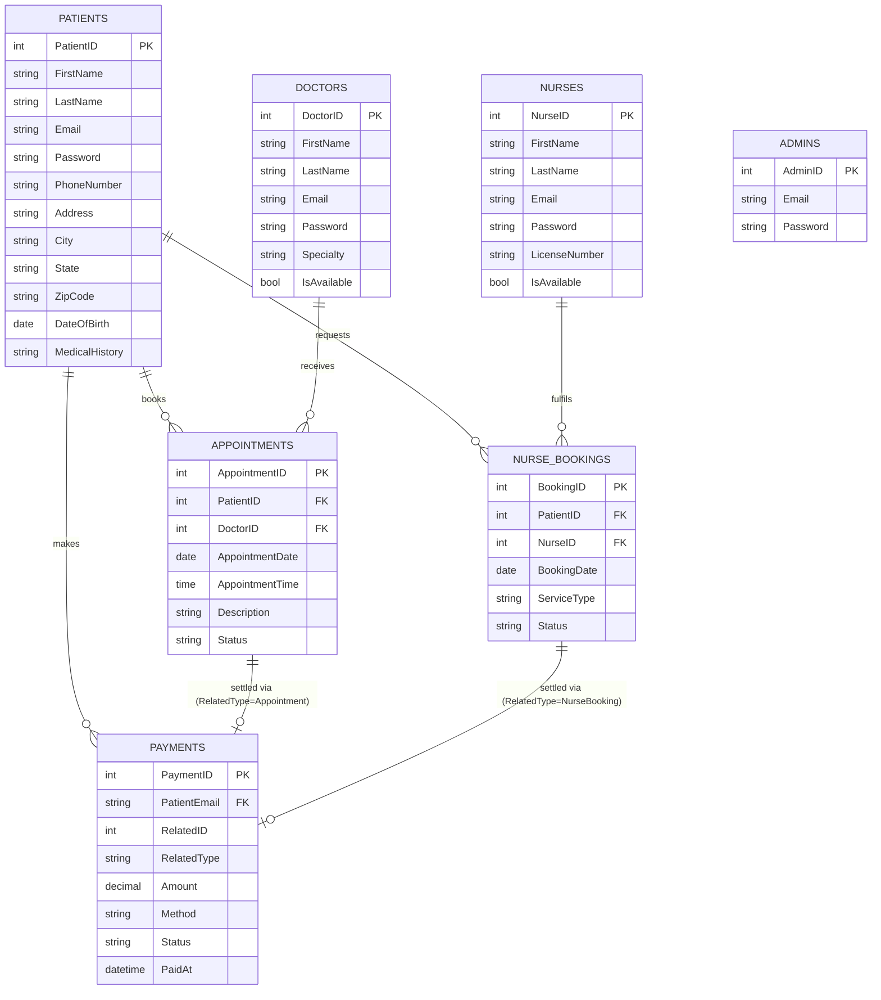

# DocAtHome — System Diagrams

> Render these in VS Code (Markdown Preview Mermaid Support), GitHub, or paste into https://mermaid.live

---

## 1. Entity-Relationship Diagram



---

### ER Notes

| Field | Allowed Values |
|-------|---------------|
| `Appointments.Status` | Pending · Accepted · Rejected · Cancelled · Completed |
| `NurseBookings.Status` | Pending · Accepted · Rejected · Cancelled · Completed |
| `NurseBookings.ServiceType` | Injection · Wound Care · IV Drip · Elderly Care · Physical Therapy |
| `Payments.RelatedType` | Appointment · NurseBooking |
| `Payments.Status` | Paid |
| `Payments.Method` | Cash · Card |

---

## 2. Activity Diagram — Full System Flow

```mermaid
flowchart TD

    START([▶ Launch App]) --> LOGIN[LoginForm\nEnter Email + Password]

    LOGIN --> VALIDATE_LOGIN{Valid\ncredentials?}
    VALIDATE_LOGIN -- No --> FAIL_LOGIN[Show error\nDecrement attempts]
    FAIL_LOGIN --> LOCKED{5 failures?}
    LOCKED -- Yes --> LOCKOUT[🔒 Account locked\n15 minutes]
    LOCKED -- No --> LOGIN

    VALIDATE_LOGIN -- New user --> REGISTER[RegisterForm\nName · Email · Password · Phone]
    REGISTER --> STRENGTH{Password\nstrong enough?}
    STRENGTH -- No --> REGISTER
    STRENGTH -- Yes --> SAVE_PATIENT[(INSERT Patients)]
    SAVE_PATIENT --> LOGIN

    VALIDATE_LOGIN -- Forgot password --> FORGOT[ForgotPasswordForm\nEnter email → OTP sent]
    FORGOT --> OTP_CHECK{OTP\ncorrect?}
    OTP_CHECK -- No --> FORGOT
    OTP_CHECK -- Yes --> RESET_PW[Enter new password\nUPDATE Patients.Password]
    RESET_PW --> LOGIN

    VALIDATE_LOGIN -- Admin --> ADMIN_DASH[AdminDashboard\nStats · Chart]
    VALIDATE_LOGIN -- Patient --> PATIENT_DASH[MainForm\nWelcome · Stat cards · History grid]
    VALIDATE_LOGIN -- Doctor --> DOCTOR_DASH[DoctorDashboard\nAppointment requests grid]
    VALIDATE_LOGIN -- Nurse --> NURSE_DASH[NurseDashboard\nBooking requests grid]

    %% ─── ADMIN BRANCH ───────────────────────────────────────────
    ADMIN_DASH --> A1[Manage Doctors]
    ADMIN_DASH --> A2[Manage Nurses]
    ADMIN_DASH --> A3[Manage Patients]
    ADMIN_DASH --> A4[Doctor Bookings]
    ADMIN_DASH --> A5[Nurse Bookings]

    A1 --> A1a[Register / Remove Doctor\nManageDoctorsForm]
    A2 --> A2a[Register / Remove Nurse\nManageNursesForm]
    A3 --> A3a[Search / Remove Patient\nManagePatientsForm]
    A4 --> A4a{Create\nnew booking?}
    A4a -- Yes --> A4b[AdminBookDoctorForm\nPick patient + doctor + date/time]
    A4b --> APPT_SAVE[(INSERT Appointments\nStatus = Pending)]
    A4a -- No --> A4c[View / filter all appointments]
    A5 --> A5a{Assign\nnurse?}
    A5a -- Yes --> A5b[AdminBookNurseForm\nPick patient + nurse + service]
    A5b --> NB_SAVE[(INSERT NurseBookings\nStatus = Pending)]
    A5a -- No --> A5c[View / filter all nurse bookings]

    %% ─── PATIENT BRANCH ─────────────────────────────────────────
    PATIENT_DASH --> P1[📅 Book Doctor]
    PATIENT_DASH --> P2[👩‍⚕️ Book Nurse]
    PATIENT_DASH --> P3[💳 Pay Selected]
    PATIENT_DASH --> P4[✕ Cancel Pending]
    PATIENT_DASH --> P5[👤 My Profile]

    P1 --> P1a[BookDoctorForm\nPick doctor · date · time · reason]
    P1a --> P1b[(INSERT Appointments\nStatus = Pending)]
    P1b --> PATIENT_DASH

    P2 --> P2a[BookNurseForm\nPick nurse · date · service]
    P2a --> P2b[(INSERT NurseBookings\nStatus = Pending)]
    P2b --> PATIENT_DASH

    P3 --> P3a[PaymentForm\nSelect Cash or Card]
    P3a --> P3b{Method?}
    P3b -- Cash --> P3c[INSERT Payments\nStatus = Paid]
    P3b -- Card --> P3d[Enter card number\nINSERT Payments\nStatus = Paid]
    P3c --> PATIENT_DASH
    P3d --> PATIENT_DASH

    P4 --> P4a{Status\n= Pending?}
    P4a -- Yes --> P4b[(UPDATE Status = Cancelled)]
    P4a -- No --> P4c[Show: cannot cancel]
    P4b --> PATIENT_DASH

    P5 --> P5a[PatientProfileForm\nEdit name · phone · address · DOB]
    P5a --> P5b[(UPDATE Patients)]
    P5b --> PATIENT_DASH

    %% ─── DOCTOR BRANCH ──────────────────────────────────────────
    DOCTOR_DASH --> D1[Toggle Available checkbox]
    DOCTOR_DASH --> D2[View pending appointments]
    D1 --> D1a[(UPDATE Doctors.IsAvailable)]
    D2 --> D2a{Decision}
    D2a -- Accept --> D2b[(UPDATE Appointments\nStatus = Accepted)]
    D2a -- Reject --> D2c[(UPDATE Appointments\nStatus = Rejected)]
    D2b --> DOCTOR_DASH
    D2c --> DOCTOR_DASH

    %% ─── NURSE BRANCH ───────────────────────────────────────────
    NURSE_DASH --> N1[Toggle Available checkbox]
    NURSE_DASH --> N2[View pending bookings]
    N1 --> N1a[(UPDATE Nurses.IsAvailable)]
    N2 --> N2a{Decision}
    N2a -- Accept --> N2b[(UPDATE NurseBookings\nStatus = Accepted)]
    N2a -- Reject --> N2c[(UPDATE NurseBookings\nStatus = Rejected)]
    N2b --> NURSE_DASH
    N2c --> NURSE_DASH

    %% ─── LOGOUT ─────────────────────────────────────────────────
    ADMIN_DASH  --> LOGOUT([🚪 Logout → LoginForm])
    PATIENT_DASH --> LOGOUT
    DOCTOR_DASH  --> LOGOUT
    NURSE_DASH   --> LOGOUT

    %% ─── STYLES ─────────────────────────────────────────────────
    style START          fill:#0f172a,color:#fff,stroke:none
    style LOGOUT         fill:#0f172a,color:#fff,stroke:none
    style LOCKOUT        fill:#ef4444,color:#fff,stroke:none
    style ADMIN_DASH     fill:#3b82f6,color:#fff,stroke:none
    style PATIENT_DASH   fill:#10b981,color:#fff,stroke:none
    style DOCTOR_DASH    fill:#f59e0b,color:#fff,stroke:none
    style NURSE_DASH     fill:#8b5cf6,color:#fff,stroke:none
    style APPT_SAVE      fill:#1e3a5f,color:#fff,stroke:none
    style NB_SAVE        fill:#1e3a5f,color:#fff,stroke:none
```



---

## 3. Project Tree — Form & Module Hierarchy

```
DocAtHome Application
│
├── 🔐 AUTH LAYER
│   ├── LoginForm                 — Email/password login, role detection, lockout
│   ├── RegisterForm              — Patient self-registration, password strength check
│   └── ForgotPasswordForm        — OTP email verification, password reset
│
├── 👤 PATIENT PORTAL  (MainForm)
│   ├── Stat Cards                — Upcoming / Pending / Unpaid counts (live async)
│   ├── Notification Strip        — Latest accepted/rejected appointment banner
│   ├── Appointment History Grid  — All doctor appointments (sortable)
│   ├── Nurse Booking History     — Switchable view, same grid
│   ├── BookDoctorForm            — Modal: pick doctor, date, time, reason
│   ├── BookNurseForm             — Modal: pick nurse, date, service type
│   ├── PaymentForm               — Modal: cash or card, dynamic height resize
│   └── PatientProfileForm        — Edit personal details
│
├── 🩺 DOCTOR PORTAL  (DoctorDashboard)
│   ├── Availability Toggle       — Live DB update
│   └── Appointment Queue         — Accept / Reject incoming requests
│
├── 👩‍⚕️ NURSE PORTAL  (NurseDashboard)
│   ├── Availability Toggle       — Live DB update
│   └── Booking Queue             — Accept / Reject nursing requests
│
├── 🛠 ADMIN PORTAL  (AdminDashboard)
│   ├── KPI Cards                 — Doctors / Patients / Nurses / Revenue (BDT)
│   ├── Activity Chart            — SplineArea bookings trend
│   ├── ManageDoctorsForm         — Register / remove doctors
│   ├── ManageNursesForm          — Register / remove nurses
│   ├── ManagePatientsForm        — Search / remove patients + profile panel
│   ├── ViewAppointmentsForm      — All doctor bookings, search/filter + create new
│   │   └── AdminBookDoctorForm   — Modal: assign patient ↔ doctor
│   └── ViewNurseBookingsForm     — All nurse bookings, search/filter + assign new
│       └── AdminBookNurseForm    — Modal: assign patient ↔ nurse ↔ service
│
└── ⚙ INFRASTRUCTURE
    ├── DBConfig.cs               — SqlConnection factory (app.config connection string)
    ├── Theme.cs                  — Centralised button/input styling helpers
    ├── UIHelper.cs               — DataGridView styling, status cell colouring
    ├── WindowHelper.cs           — Drag-to-move, maximize/restore toggle
    ├── ValidationHelper.cs       — Email regex, password strength scoring
    ├── PasswordHelper.cs         — Password hashing
    ├── LoginAttemptTracker.cs    — In-memory lockout (5 attempts → 15 min)
    ├── OtpService.cs             — OTP generation & email delivery
    └── BookingStatus.cs          — Status / PaymentType / ServicePricing constants
```

---

## 4. Data Flow Summary

```
Patient registers / logs in
        │
        ▼
  Booking created (Pending)
        │
        ▼
  Doctor / Nurse reviews → Accepted | Rejected
        │
        ▼ (Accepted)
  Patient sees confirmation notification
        │
        ▼
  Patient pays → Payment record (Paid)
        │
        ▼
  Admin sees revenue on KPI card + chart
```
